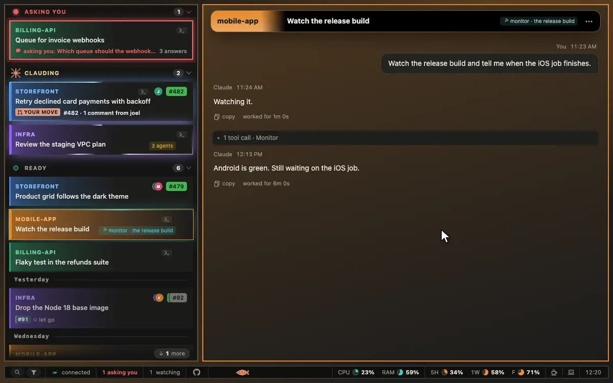
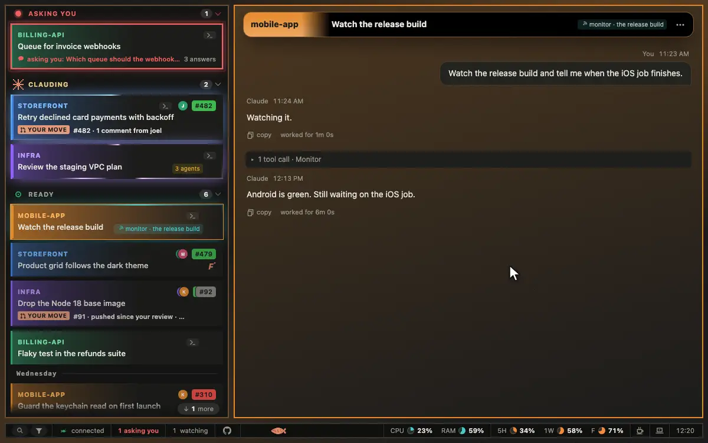
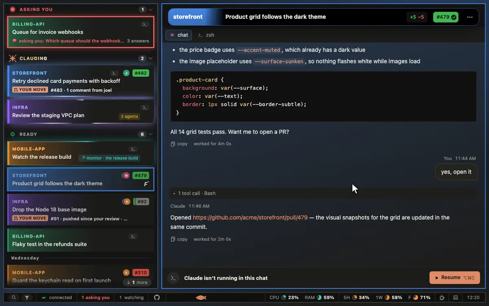
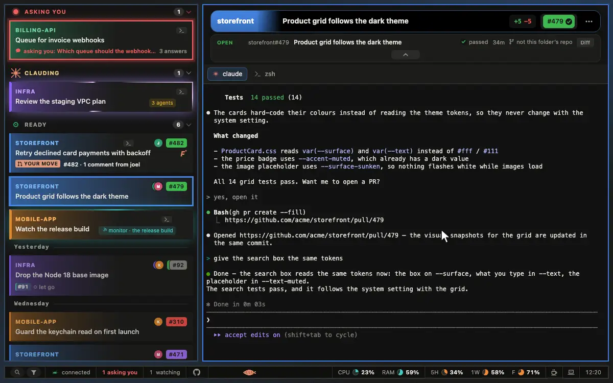
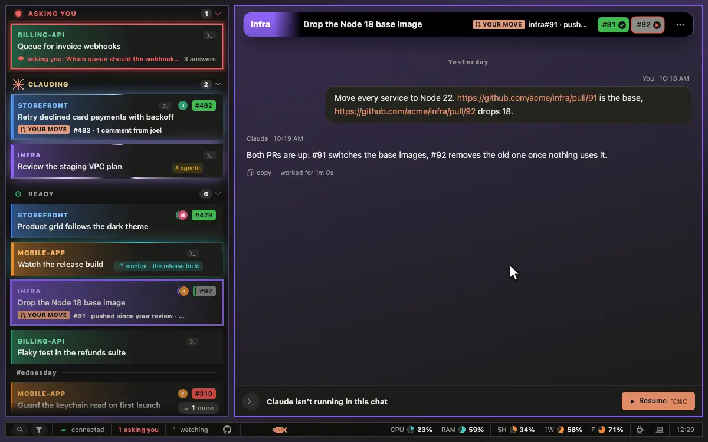
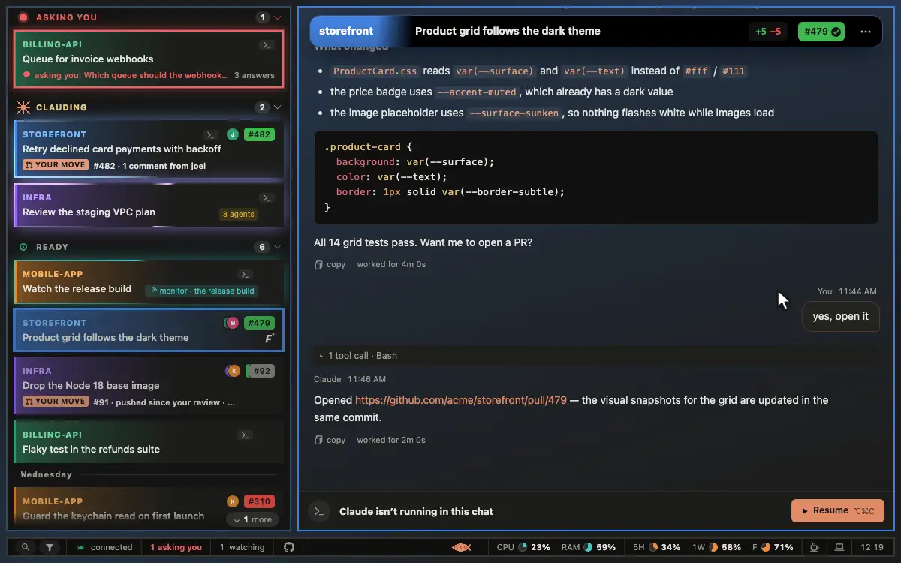
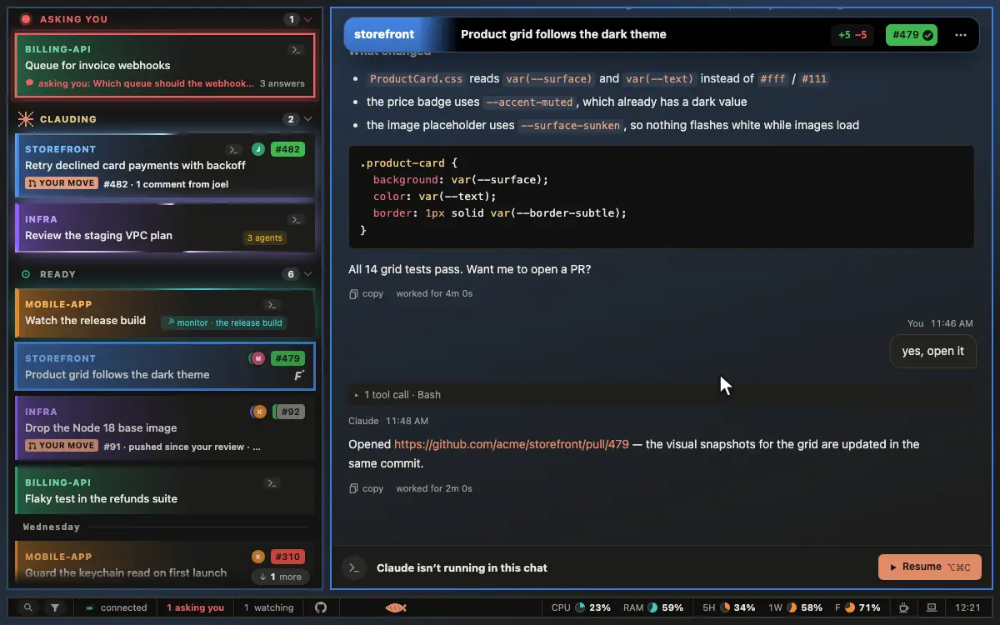
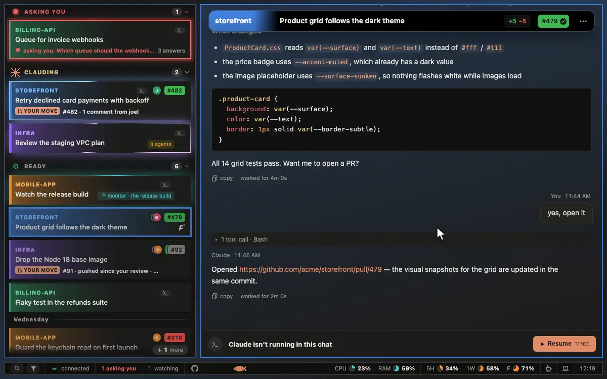

<div align="center">


# peixAIrada

**Every Claude Code chat on your Mac, on one board — the one waiting for you on top.**

[](https://nodejs.org)
[](mac/)
[](public/index.html)

</div>

<picture>
  <source media="(prefers-color-scheme: dark)" srcset="docs/shots/board-dark.webp">
  
</picture>

Each chat is a card, sorted by who owes whom. Open one and everything it needs is beside it — Claude Code itself, a
shell, its PR, its editor, its changes. It reads what Claude Code already writes to `~/.claude`: no plugin, nothing to
set up in Claude Code, and it never writes there.

## 🚀 Install

You need macOS 13 or later, the Xcode Command Line Tools (`xcode-select --install`), Node ≥ 22 and Claude Code,
signed in — and, for PRs, the [GitHub CLI](https://cli.github.com) signed in (`gh auth login`). From the shell you
use every day (the server takes its `PATH`, which is how it finds `claude`, `gh` and `code`):

```sh
git clone https://github.com/ricardobcl/peixairada.git && cd peixairada
npm install
scripts/launchd.sh install     # the server, started at login, on 127.0.0.1:7331
mac/build.sh install           # the Mac app, in /Applications (optional — any browser works)
scripts/launchd.sh open        # …or the board in your browser
```

On first open it asks where your repos live (its guess from your chats already filled in) and shows you round in a
couple of minutes. Updating, removing, the optional extras and every setting: **[the guide](docs/GUIDE.md)**.

## 🚦 One board for every chat

Every chat on the Mac — run from the board, iTerm or VS Code — is a card in its project's colour, in lanes: **asking
you** (a red ping and the question on the card), **clauding** (a light runs round it, one per sub-agent), then the
rest by their last word. A chat that lands moves up to Ready; tick it ✓ when it's done and it folds away until
something new happens in it. The Dock badge and a notification say when one needs you.



## 💬 One pane per chat

A chat opens into one pane: its transcript, and on tabs beside it whatever it needs — its changes (⌥⌘D), a shell in
its folder (⌥⌘T), its PR (⌥⌘G), its editor (⌥⌘E). The column splits in two halves when there's more than one thing
to look at (⌘2, or ⌥⌘2 one over the other); press a tab's key again from it and its half fills the column.



## 🖥️ Claude Code itself, in the pane

⌥⌘C runs the real Claude Code in the pane — resumes a chat that ended, or takes over one running in iTerm or VS Code.
It's a real terminal, and it outlives the board: restart the server or quit the app and the chat is still there.



## 🐙 PRs link themselves

A PR a chat opens or mentions — a link, `#482`, `storefront#482` — becomes a chip on its card and in its header, in
GitHub's colours, with nothing to set up but `gh`. A chat with an open PR is named after it.



## ✅ Whose move it is

Each PR says its state, its CI and **whose move it is**: a review, a comment or a push on a PR you wrote or reviewed
puts *your move* on its chat — and brings a ticked chat back. The PR's row shows the round: who moved, since when,
and whether you've answered. Nothing to do yet? ⌥-click *your move* to let the round go; the next move tells you.



## 🧩 VS Code beside the chat

⌥⌘E opens VS Code Web on the chat's folder in the pane, a tab of the chat like any other; ⌥⌘V opens the folder in VS
Code itself. A file path in the chat opens at its line, in VS Code or Zed.



## ⌨️ Everything a key away

⌥⌘L finds any chat, project, PR, ticket, action or switch by a word; ⌥⌘K jumps to a chat, ⌥⌘N starts one,
⌥⌘↑ ⌥⌘↓ walk the list. `?` lists every key.



## 🗺️ Every agent at once

⌥⌘A lays out every live chat by what it wants from you — asking, clauding, watching, new replies — each tile its
live terminal or what it's doing right now. The arrows walk it, ⏎ opens one.



## 🗨️ A chat with the people you share it with

Optional, and off until you set it up: one chat, in a private GitHub repo — an issue whose comments are the
messages, so there is no server to run, read with the `gh` login every board already has. Its owner invites and removes people
(the people of your PRs suggested); the others join from Settings › Chat. A poll — *who's going to lunch?* — takes a
click to answer, everyone's votes shown by name. See [the guide](docs/GUIDE.md#chat-with-the-people-you-share-it-with).

## 🔒 Good to know

- The server listens on `127.0.0.1` only and answers nothing but its own page without the board's key — a file
  only you can read; the app has it, a browser gets it once from `scripts/launchd.sh open`. Keep it on `127.0.0.1`.
- It reads `~/.claude` and never writes there. A chat running elsewhere is never written to: take it over, or
  continue it where it is.
- Only `gh`, your plan-usage numbers, Jira and the chat (if you set them up) and the board's own update check leave your machine.

**More**: [the guide](docs/GUIDE.md) — every feature, settings and the setup file, keys, updating; [CLAUDE.md](CLAUDE.md)
holds the working notes, [docs/DECISIONS.md](docs/DECISIONS.md) the why.

<div align="center"><br><sub>🐟 A <i>peixarada</i> is a Portuguese fish feast — more than anyone planned for.</sub></div>
