<div align="center">

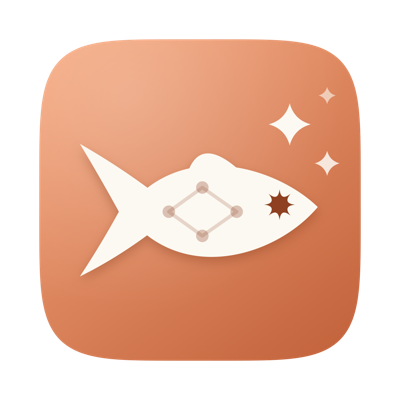

# peixAIrada

**Every Claude Code chat on your Mac, on one board — the one waiting for you on top.**

[](https://nodejs.org)
[](mac/)
[](public/index.html)

</div>

<picture>
  <source media="(prefers-color-scheme: dark)" srcset="docs/shots/board-dark.webp">
  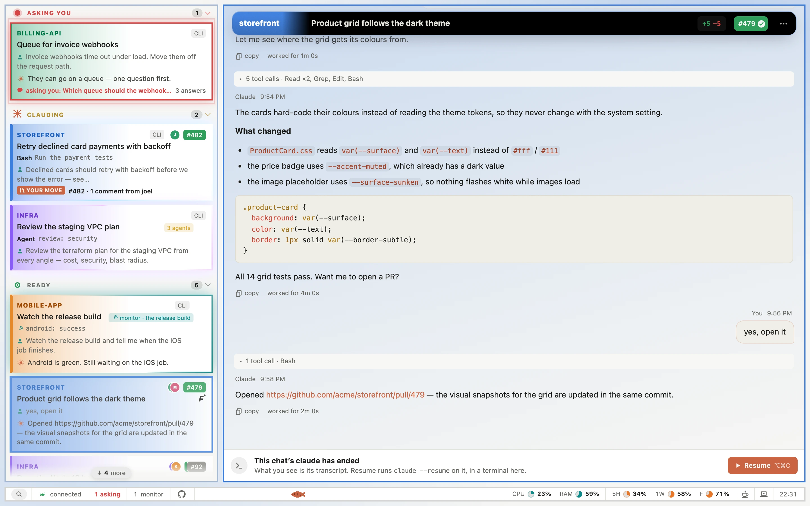
</picture>

It reads what Claude Code already writes to `~/.claude` — no plugin, no private API, and it never writes there.

## 💬 Everything about a chat, beside it

Open a chat and its terminal, its PR, its editor and its changes are a key away — each on a tab of the chat, the
column split in two halves when there's more than one thing to look at.

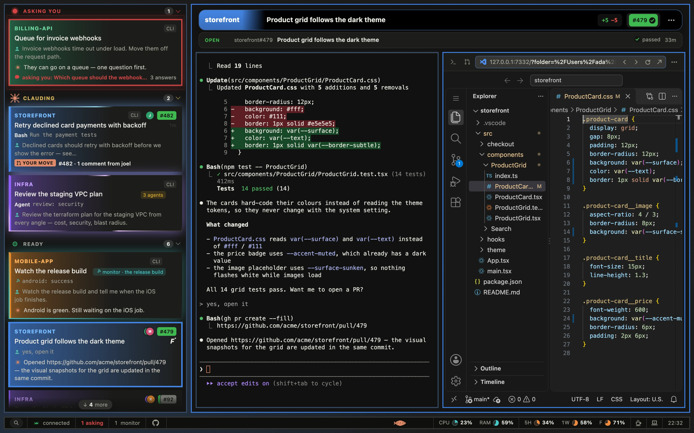

| Key | Beside the chat |
|---|---|
| ⌥⌘C | 🖥️ **Claude Code itself** — the real terminal, in a drawer: resume any chat, or take over one running in iTerm or VS Code. A chat whose Claude has ended resumes 5 s after you open it (or on a click), cloning its repo first when its folder isn't checked out. Drawers survive the board's restarts. |
| ⌥⌘T | 🐚 **A shell** in the chat's folder, on a tab of its own. |
| ⌥⌘G | 🐙 **The PR on GitHub** — its page on a tab; its state, its CI and whose move it is under the header. |
| ⌥⌘E | 🧩 **VS Code Web** on the chat's folder. |
| ⌥⌘D | 🔀 **The chat's changes** — this turn's edits, everything uncommitted, or the branch against its base, as a diff. Commit… and Push type into its shell; a note on a line goes to Claude. |
| ⌘2 · ⌥⌘2 | ◫ **Split** the column side by side, or one half over the other; drag a tab across, ⌘W closes a half. |

GitHub and VS Code open in the chat in the Mac app; in a browser they open in a tab of their own.

<table>
  <tr>
    <td>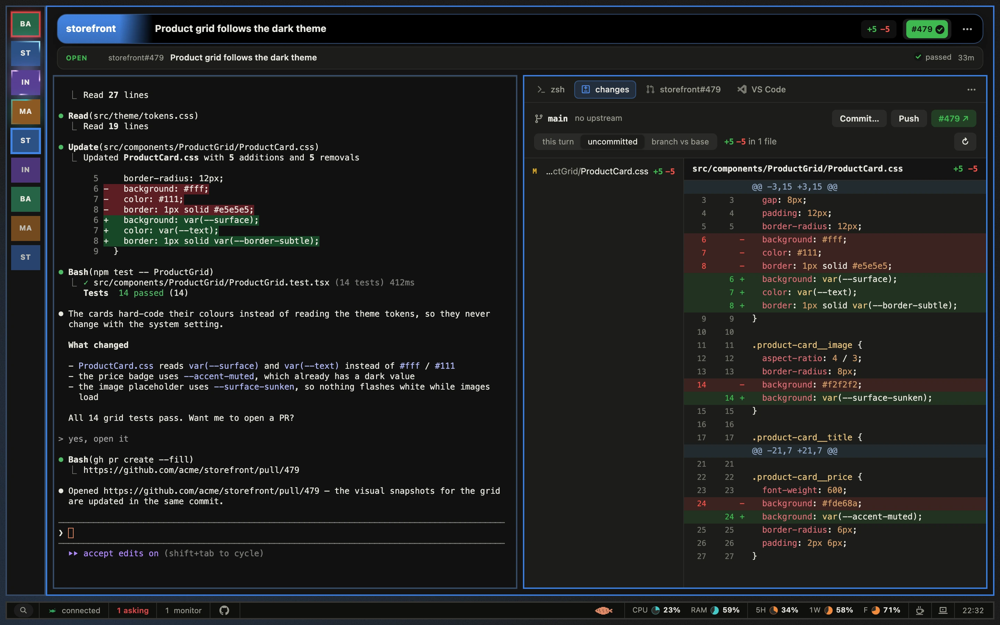</td>
    <td>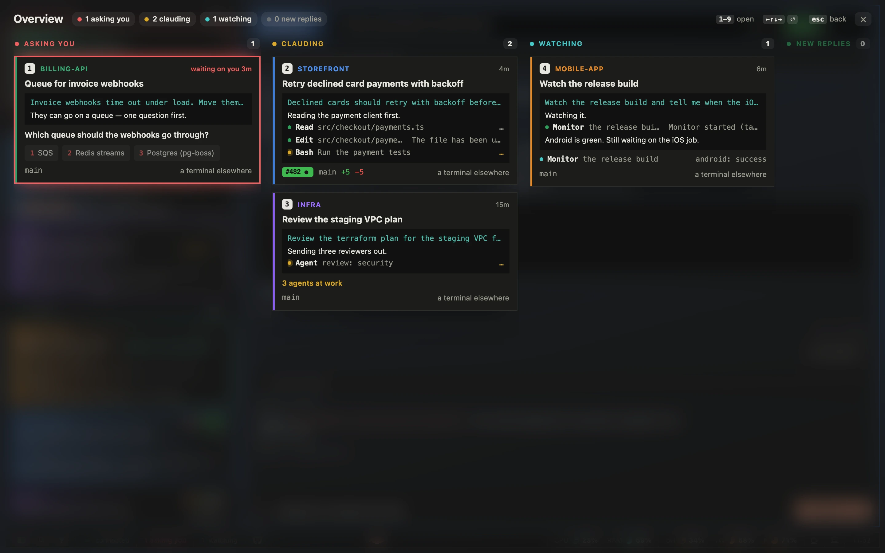</td>
  </tr>
  <tr>
    <td align="center"><sub>⌥⌘D — the diff of what Claude just did, the list folded to a rail (⌥⌘B)</sub></td>
    <td align="center"><sub>⌥⌘A — every agent at once, by what it wants from you</sub></td>
  </tr>
</table>

## ✨ Features

- 🚦 **Sorted by who owes whom** — in lanes: asking you, clauding, then the rest by their last word — ready, and idle
  (untouched for more than four days). *Done* is a tick you give; Idle and Done start folded, and a click on any lane's
  head folds or opens it. **The funnel** beside the search shows only the chats with a PR at your move, or only those
  Claude answered since you last looked. Cards are compact unless you'd rather — or large only for the chats that want
  you.
- 💡 **The card's edge tells you why it's busy** — each card a lit edge in its project's colour; a light runs round it
  (or down the edge, if you'd rather) while Claude works, one per sub-agent, slower for a monitor; a question pings out
  in red.
- 🔔 **Alerts** — a notification when a chat finishes or needs you, answered where it shows in the app: *Reply…*
  (straight into the chat's Claude, when its drawer runs here), *Done*, or *In 15 minutes*. The Dock badge and the
  menu bar count the chats asking you and those with a new reply; the menu lists them, your PRs' moves and what is
  clauding.
- 🐙 **PRs** — chips in GitHub's colours, stacked on a card and fanned out under the pointer (scroll them when they're
  more than fit); a chat with an open PR is named after it. A PR you reviewed or wrote fills in, notifies you and brings its ticked chat back when it's your
  move again — a push, a reply, a review. Nothing to do yet? ⌥-click *your move* to let the round go: the next move
  tells you. ⌥-click the ✓ to tick a chat done for good: its PRs won't bring it back. Take a PR
  off a chat from its chip's right-click menu (or ⌥-click) — until you name it there yourself.
- 🎫 **Jira tickets** — a ticket a chat names (`ACME-12`, a link, its branch) wears its status on the card and in the
  header, beside its PRs. Set your site, email and an API token in Setup.
- 🎨 **Projects** — folders in their [Peacock](https://marketplace.visualstudio.com/items?itemName=johnpapa.vscode-peacock)
  colour, or named sets of folders.
- 🌑 **Simple colours** — a quieter board: every project in black (or one colour you pick), the states in grey; PRs
  and faces keep their colours, and the accent is left for what needs you.
- 🗺️ **Every agent at once** — ⌥⌘A lays out every live chat by what it wants (asking, clauding, watching, new replies),
  each showing what it is doing right now; the *tiles* switch lays the board out as Hyprland does, and ⌥⌘S stacks the
  busy chats beside the open one.
- 🏠 **Home** — with no chat open: an ASCII sunset at sea with our fish leaping across the sun (click it), the board at
  a glance — each count a way to what it counts — and your day, every chat's turns and how long each waited on you.
- 🎨 **Themes** — Omarchy's twelve (Tokyo Night, Catppuccin, Gruvbox, Nord, Rosé Pine…), dark or light whatever macOS
  shows — or one of each, following it; your projects keep their hue in the theme's shades.
- 🐟 **It moves when something happens** — counts roll to their new value, a ✓ draws itself, an answered question's
  ring closes in, a PR's CI is drawn in as it lands; a clauding card names the tool it is running, a monitor's card
  its newest event; a pixel fish in the status bar swims back and forth, faster the more agents are at work, blurps bubbles ahead of
  itself and chases them down (it wiggles when the pointer pats it), and floats belly-up while the board has lost its server. In the app the trackpad bumps as a divider snaps; sounds, if you switch them on. All of it stills under the system's
  *reduce motion*.
- 📊 **A status bar** — along the window's foot: the search, the connection, what asks you, the faces on your PRs,
  your plan's limits (or its monthly spend cap) as small pies, keeping the Mac awake (with the lid closed too,
  by Touch ID where sudo takes it; greyed out when the Mac wouldn't sleep anyway, as on a charger set never to), CPU and memory as pies too, optionally what Claude's processes hold — and the time, at the far right.

<table>
  <tr>
    <td>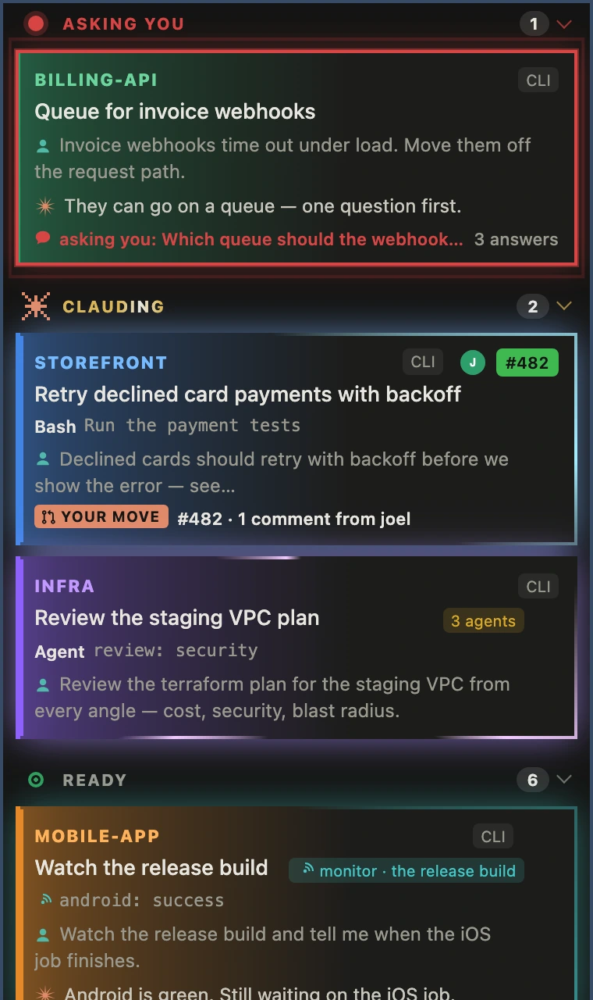</td>
    <td>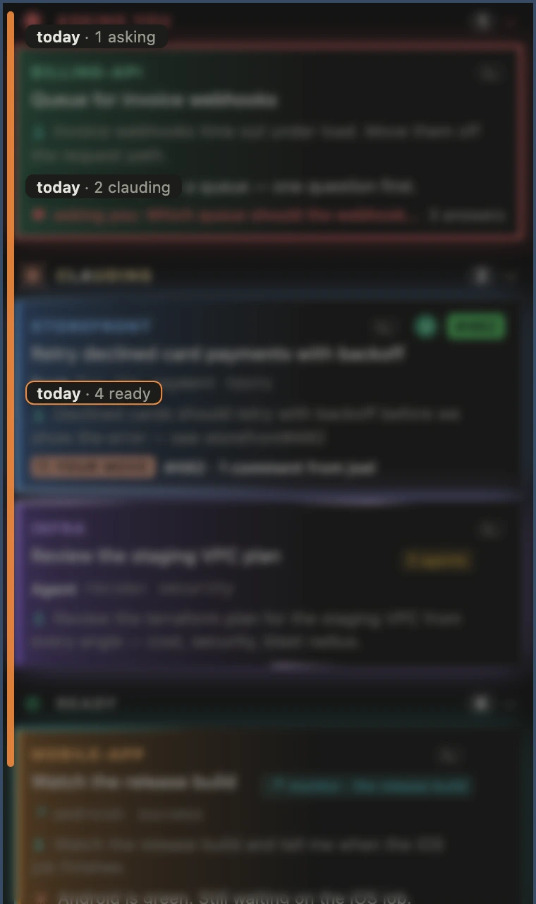</td>
  </tr>
  <tr>
    <td align="center"><sub>asking · clauding, your move on its PR · sub-agents · watching</sub></td>
    <td align="center"><sub>point at the scrollbar and the days come out</sub></td>
  </tr>
</table>

<p align="center">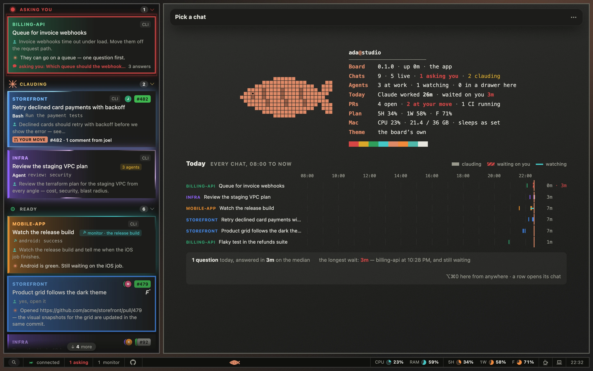<br><sub>⌥⌘0 — home: the board at a glance, and your day</sub></p>

## 🎛️ Make it yours

Every look is a switch in Settings › Board (⌘,), or a key — and the board starts with tiles and the floating header on,
as at the top.

<table>
  <tr>
    <td>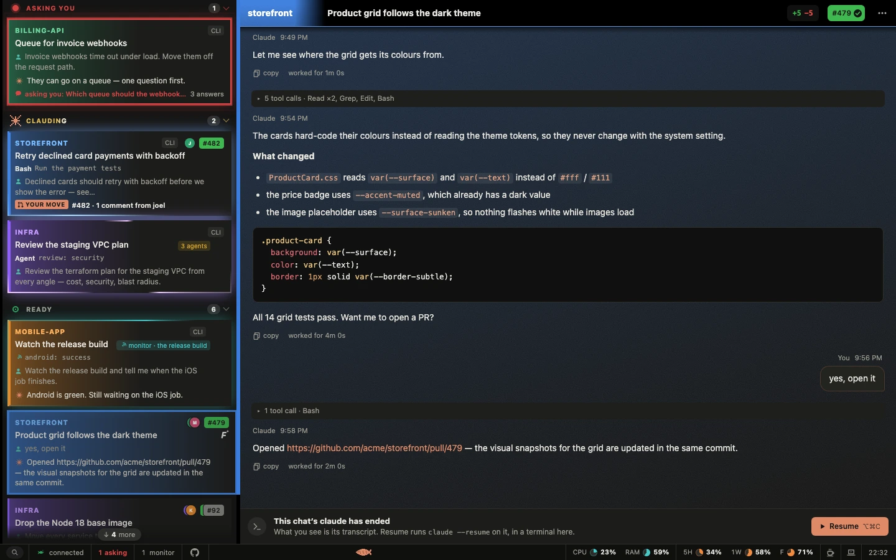</td>
    <td>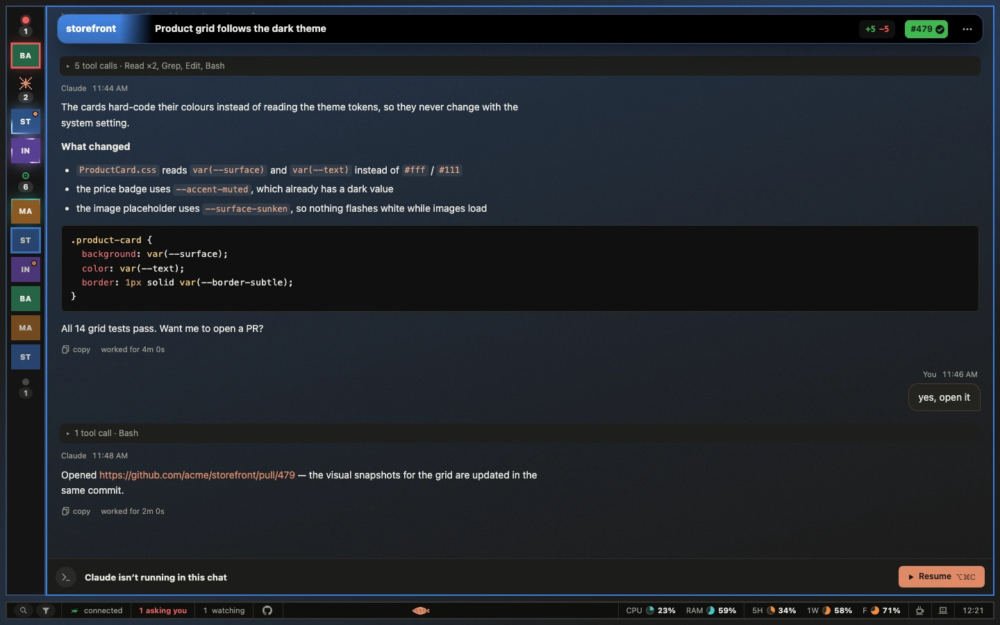</td>
  </tr>
  <tr>
    <td align="center"><sub><b>Tiles</b> off — the plain column, the header edge to edge</sub></td>
    <td align="center"><sub><b>⌥⌘B</b> — the list folded to a rail, a square per chat</sub></td>
  </tr>
  <tr>
    <td>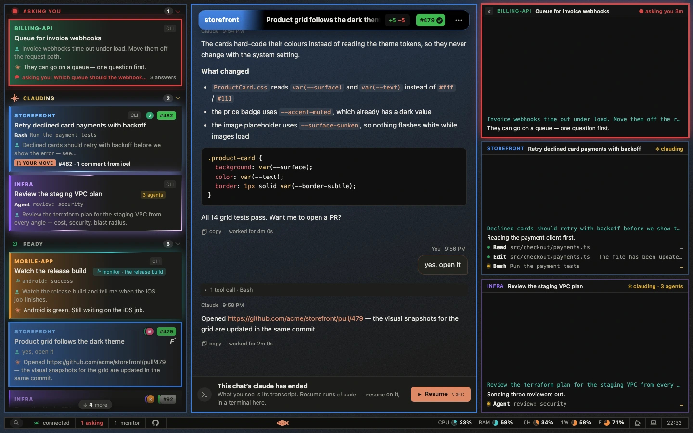</td>
    <td>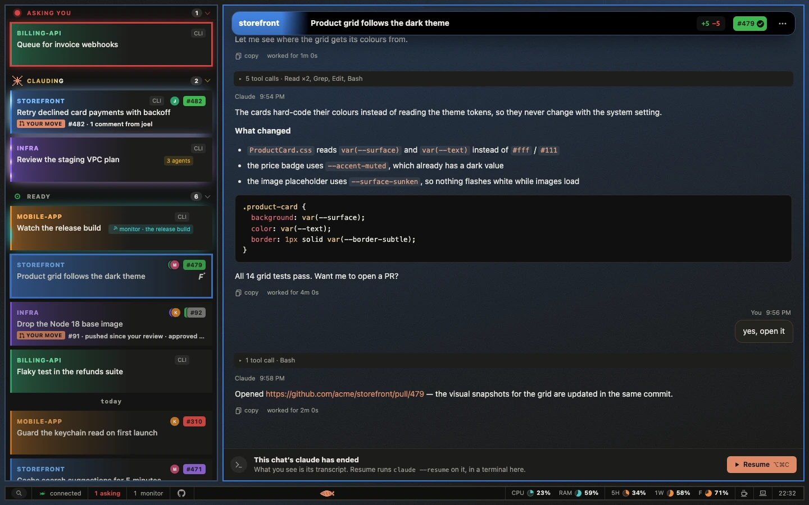</td>
  </tr>
  <tr>
    <td align="center"><sub><b>⌥⌘S</b> — the busy chats stacked beside the open one, live</sub></td>
    <td align="center"><sub><b>Compact</b> cards, one height, and the <b>edge light</b></sub></td>
  </tr>
  <tr>
    <td>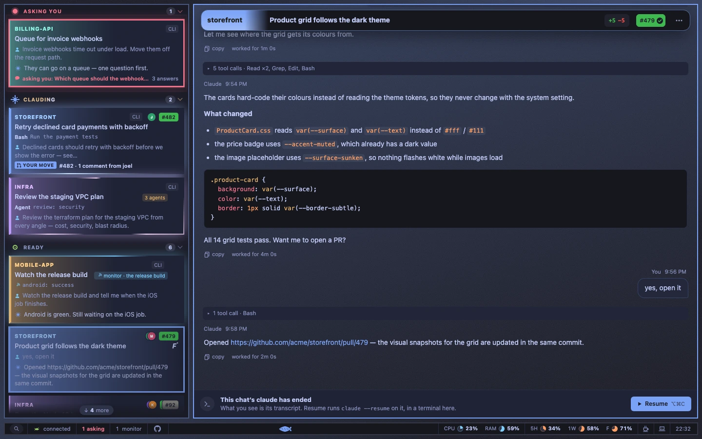</td>
    <td>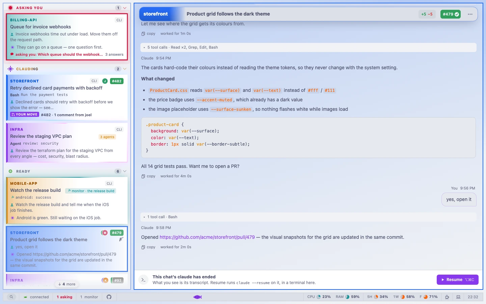</td>
  </tr>
  <tr>
    <td align="center"><sub><b>⌥⌘Y</b> — a dark theme (Tokyo Night)…</sub></td>
    <td align="center"><sub>…or a light one (Catppuccin Latte), whatever macOS shows</sub></td>
  </tr>
  <tr>
    <td>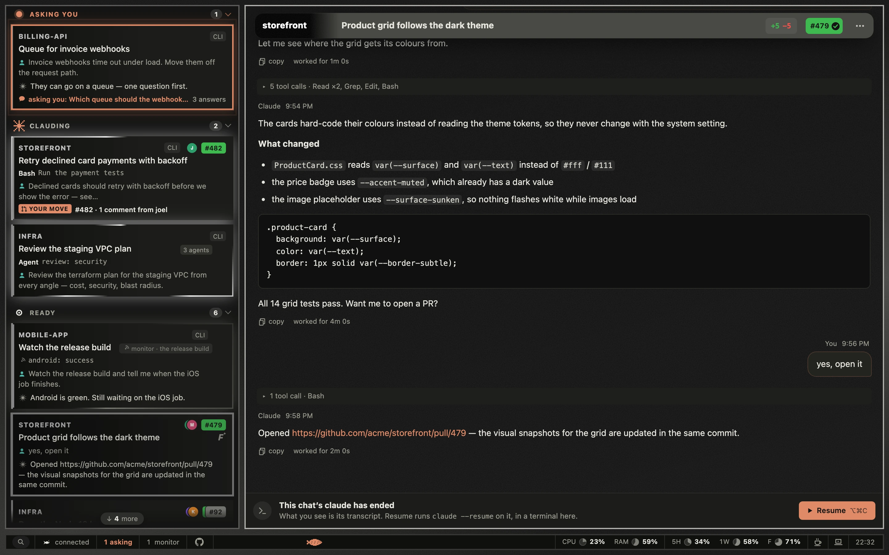</td>
    <td>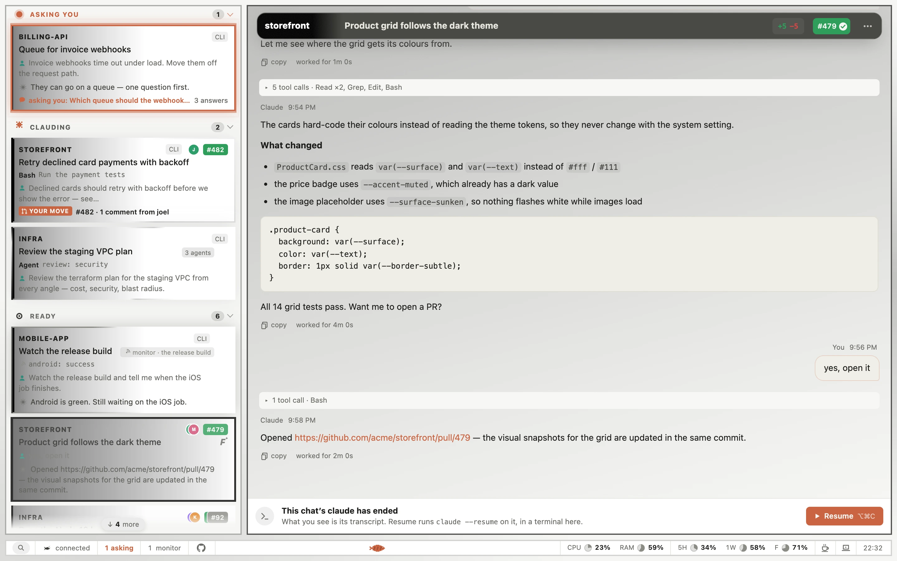</td>
  </tr>
  <tr>
    <td align="center" colspan="2"><sub><b>Simple colours</b> — every project in black (or one colour you pick), the states in grey; PRs and faces keep theirs</sub></td>
  </tr>
</table>

## 🚀 Install

**First, what it runs on** — the last three are optional: without one, only what it is for is missing.

| | For | Install |
|---|---|---|
| macOS 13 or later | the app, the login agent, the keychain | |
| Xcode Command Line Tools | `git`, and `swiftc` for the app | `xcode-select --install` |
| Node ≥ 22 | the server | `brew install node` — or mise, nvm, asdf |
| Claude Code, signed in | the chats themselves | `curl -fsSL https://claude.ai/install.sh \| bash`, then run `claude` once to sign in |
| [GitHub CLI](https://cli.github.com), signed in | PR states, faces and turns, cloning | `brew install gh && gh auth login` |
| VS Code | ⌥⌘E (VS Code Web); [Peacock](https://marketplace.visualstudio.com/items?itemName=johnpapa.vscode-peacock) for project colours | [code.visualstudio.com](https://code.visualstudio.com) |
| [Task](https://taskfile.dev) | folders whose Taskfile starts Claude | `brew install go-task` |

**Then**, from the shell you use every day — the login agent keeps its `PATH` and its `node`, which is how it finds
`claude`, `gh` and the rest:

```sh
git clone git@github.com:ricardobcl/peixairada.git && cd peixairada
npm install                    # node-pty comes prebuilt for macOS: no compiler needed
scripts/launchd.sh install     # the server, started at login → http://127.0.0.1:7331
mac/build.sh install           # the Mac app, in /Applications (optional — any browser works)
```

**On first open** the board asks where your repos live, its guess from your chats already filled in. macOS asks to let
`security` read the *Claude Code-credentials* keychain item (that's the plan usage — *Always Allow*), and the app to
show notifications.

**Updating** is the board's own job: every half hour it looks for new commits on your checkout's branch and, once
you've left it be for two minutes, pulls them — a fast-forward, never over a change of yours — and starts again what
they changed: the packages, the server (your chats stay open), the page, the app. A commit whose server doesn't start
is undone and skipped. Settings › Board › *Updates* says where it stands, checks now, or turns it off; off, it's
`git pull && npm install`, then `scripts/launchd.sh restart` and `mac/build.sh install` when `mac/` changed. After
switching Node versions, or installing a CLI somewhere new, run `scripts/launchd.sh install` and `mac/build.sh install`
again.

**Removing**: `scripts/launchd.sh uninstall`, then delete `/Applications/peixAIrada.app` — and `~/.config/peixairada`
and `~/Library/Application Support/peixAIrada` to forget your setup and the board's state.

## ⚙️ Setup

**Settings** — ⌘, or ··· in the chat's header:

- **Board** — *Alerts*: notifications, sounds · *Chats*: card size (compact, or large only where a chat wants you),
  auto-resume · *Look*: text size (the whole board, in the app), simple colours (every project in black, or one colour
  you pick, the states in grey), the theme and whether it follows macOS, tiles and their stack and glow, the floating header (tiles and the header
  on to begin with), the status bar and what it shows · *Terminal*: ⌥ as Meta, a screen reader in the drawer ·
  *Updates*: whether the board updates itself, where it stands, check now · and,
  folded, *Lights and motion*: the card light (round the card or down its edge), rings in step, the light under the
  pointer.
- **Setup** — your repo folders and their GitHub org (⌥⌘N lists every repo and clones the ones you don't have), the
  project ⌥⌘O starts a chat in, a short name and a colour where Peacock has none, per project, and your Jira site,
  email and API token (the token goes to your keychain, never into the file).

The setup is a file of yours, `~/.config/peixairada/config.json` (`$XDG_CONFIG_HOME` moves it) — edit it by hand or
keep it with your dotfiles; the board picks up a change within seconds:

```json
{
  "roots": [{ "dir": "~/code", "org": "my-org" }],
  "quick": "my-service",
  "projects": { "my-service": { "abbr": "SVC", "color": "#2f7fd8" } },
  "jira": { "site": "https://my-org.atlassian.net", "email": "me@my-org.com" }
}
```

What the board records as you use it — done ticks, titles, pins — stays in `~/Library/Application Support/peixAIrada/`.

<details>
<summary>Environment variables</summary>

| Variable | Default | |
|---|---|---|
| `PORT` | `7331` | the board's port |
| `NOTIFY` | `native` (`off` with the app) | who posts notifications |
| `USAGE` | on | `off` hides the plan usage |
| `JIRA_API_TOKEN` | the keychain's | the Jira token, if you'd rather not keep it in the keychain |
| `DRAWER_IDLE_MS` | 24 h | an unwatched idle drawer ends itself; `0` never |
| `VSWEB_FRESH_MS` | 1 h | how often VS Code Web's newest build is fetched ahead of time; `0` never |
| `CLAUDE_BIN` `GH_BIN` `CODE_BIN` `TASK_BIN` | from `PATH` | where the CLIs are |
| `CLAUDE_DIR` · `STATE_FILE` | `~/.claude` · `~/Library/Application Support/peixAIrada/state.json` | what it reads · keeps |
| `CONFIG_FILE` | `~/.config/peixairada/config.json` (beside `STATE_FILE` when that is set) | the setup |

The login agent takes `PORT`, `NOTIFY` and your `PATH` at `scripts/launchd.sh install`.

</details>

## ⌨️ Keys

| Key | Does |
|---|---|
| ⌥⌘K | jump to any chat |
| ⌥⌘N · ⌥⌘O | new chat · new chat in your ⌥⌘O project |
| ⌥⌘P · ⌥⌘F | pick a project · filter the list |
| ⌥⌘↑ ⌥⌘↓ | previous · next chat |
| ⌥⌘C | this chat's Claude, in the drawer |
| ⌥⌘T · ⌥⌘E · ⌥⌘G | a shell · VS Code Web · the PR |
| ⌘2 · ⌘W | split · close a half |
| ⌥⌘B | fold the list |
| ⌥⌘L | the launcher: chats, projects, PRs, tickets, actions, switches |
| ⌥⌘A · ⌥⌘D · ⌥⌘0 | the overview: every live chat at once · this chat's changes · home |
| ⌥⌘S | the busy chats stacked beside the open one (tiles) |
| ⌥⌘Y | the theme |

`?` (or Settings › Keys) lists the rest, grouped. A right-click on a card, a PR chip or a project's colour square has
what ⌥-click and a double-click do — rename, tick done, take a PR off, let go of a colour — and the launcher has the
same for the open chat.

<p align="center">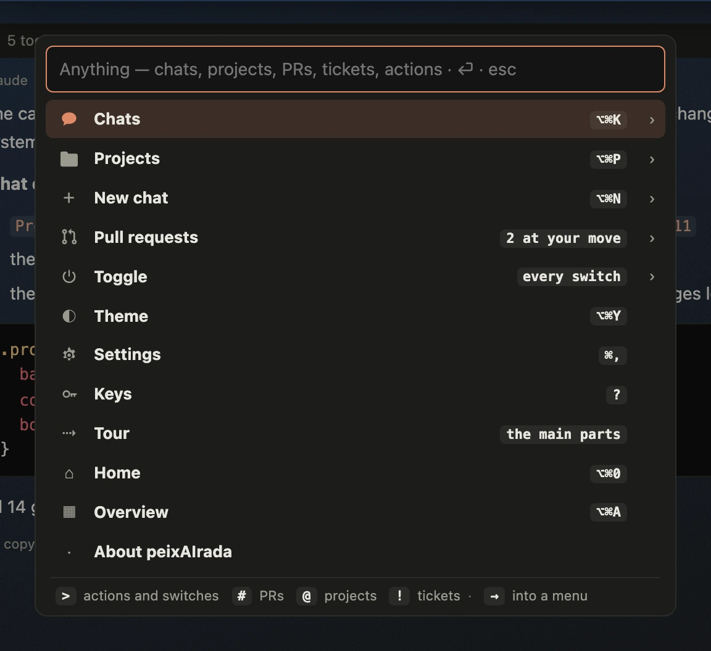</p>

## 🔒 Good to know

- Transcripts hold everything Claude read. The server listens on `127.0.0.1` only, with no login — keep it that way.
- Only `gh` (PR states, clones), the plan-usage call, Jira (once you set it up), a `git fetch` of the board's own
  checkout every half hour (its updates) and, with VS Code installed, an hourly look at VS Code's update service (so VS
  Code Web has its newest build before you open it) leave your machine.
- A chat running elsewhere is never written to: take it over, or continue it where it is.

## 🛠 Hacking

`npm test` · `npm run check` · `npm run scenarios` — and `npm run scenario -- scripts/readme-shots.mjs` redraws these
screenshots from a made-up board (VS Code Web's wants the `code` CLI). The browser checks drive Google Chrome (`CHROME`
points at another); `npm run webkit` runs the board in WebKit, the app's engine.
[CLAUDE.md](CLAUDE.md) holds the working notes, [docs/DECISIONS.md](docs/DECISIONS.md) the why.

Home's sunset is [*ocean sunset*](https://ascii.rest/ocean-sunset/) by [bas3line](https://github.com/bas3line/ascii)
(MIT), ported as it stands; the leaping fish is ours.

<div align="center"><br><sub>🐟 A <i>peixarada</i> is a Portuguese fish feast — more than anyone planned for.</sub></div>
