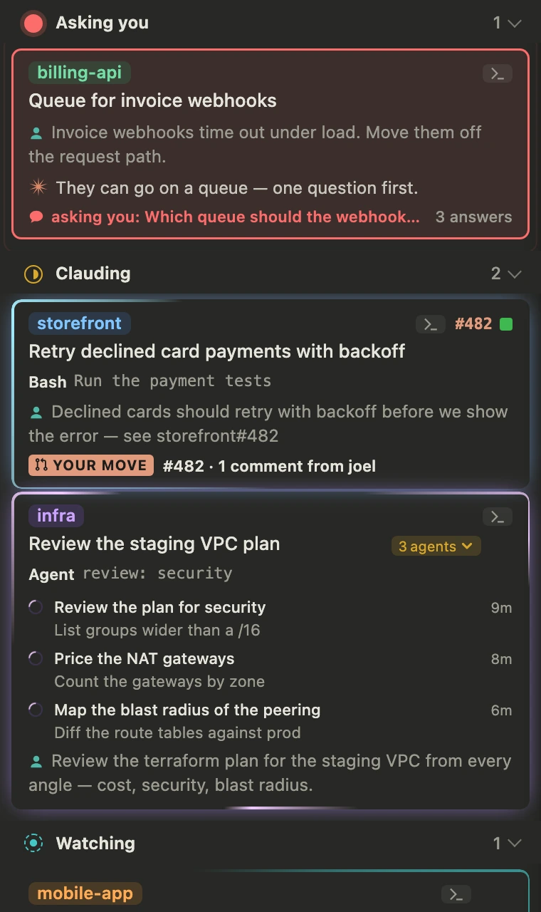
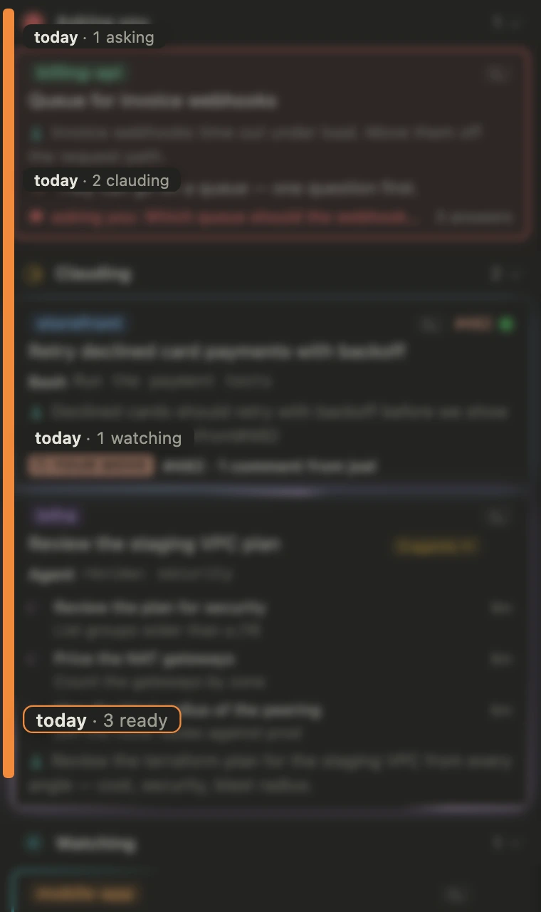
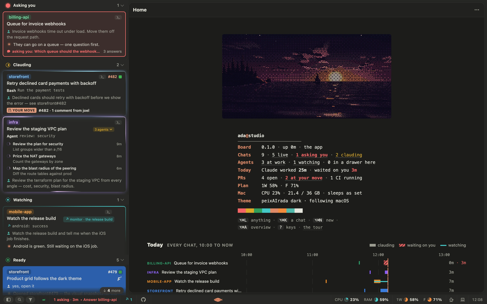
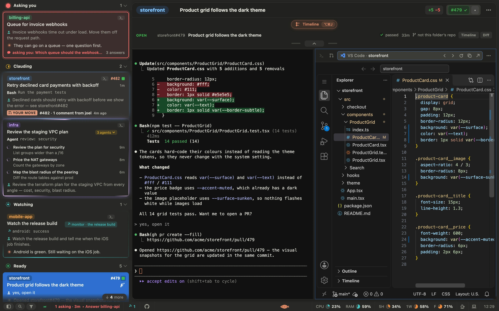
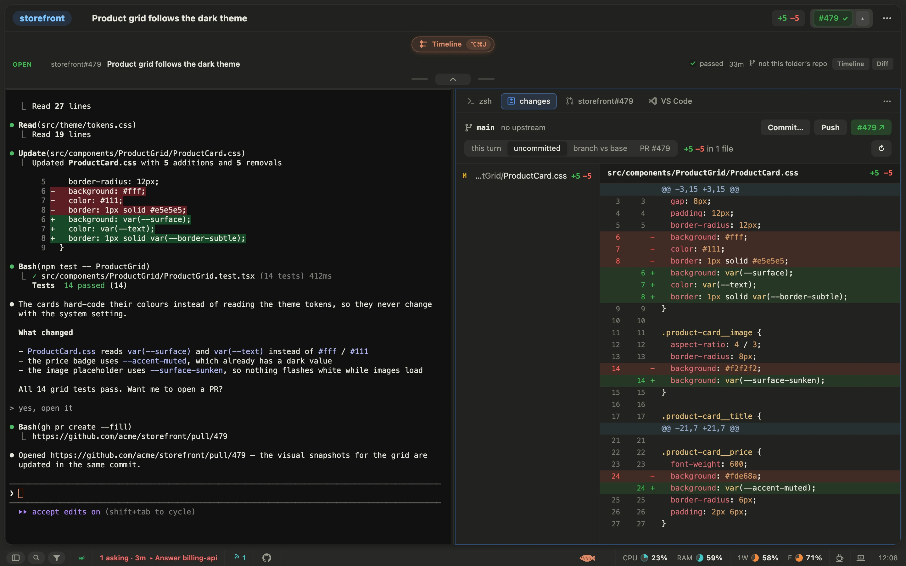
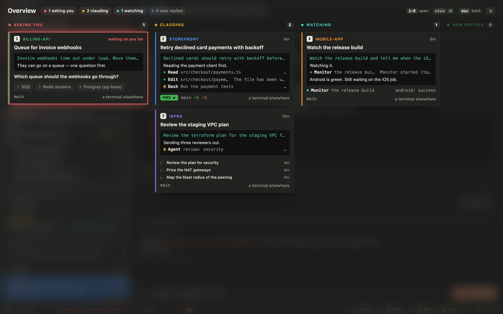
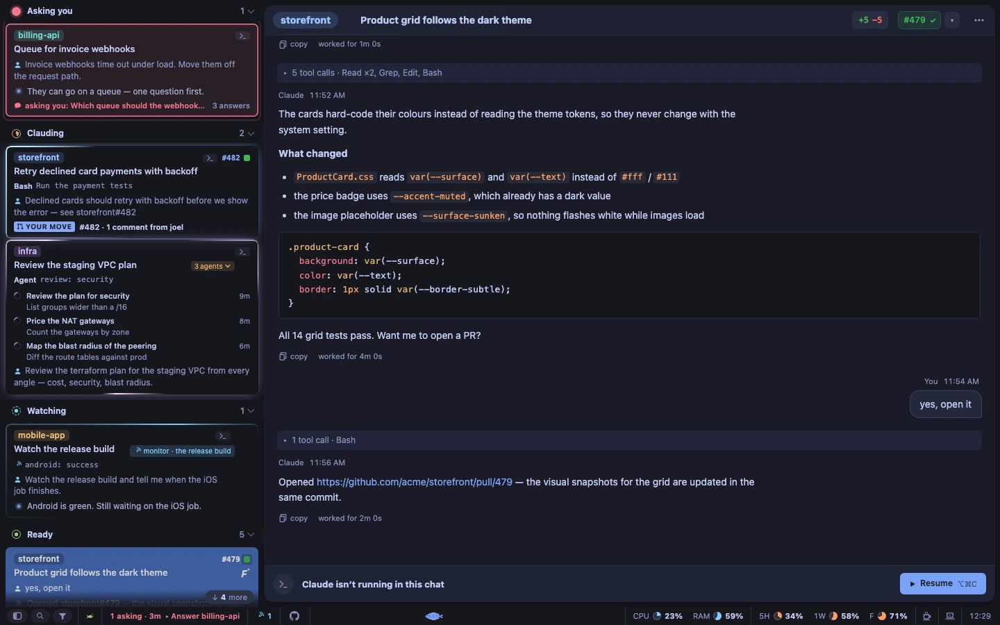
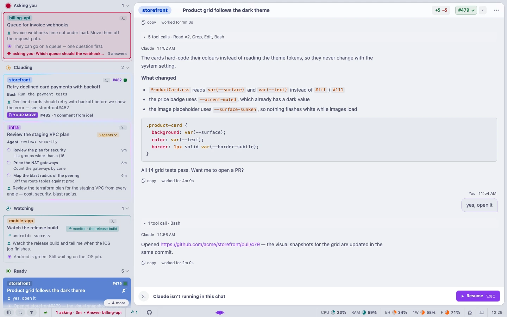
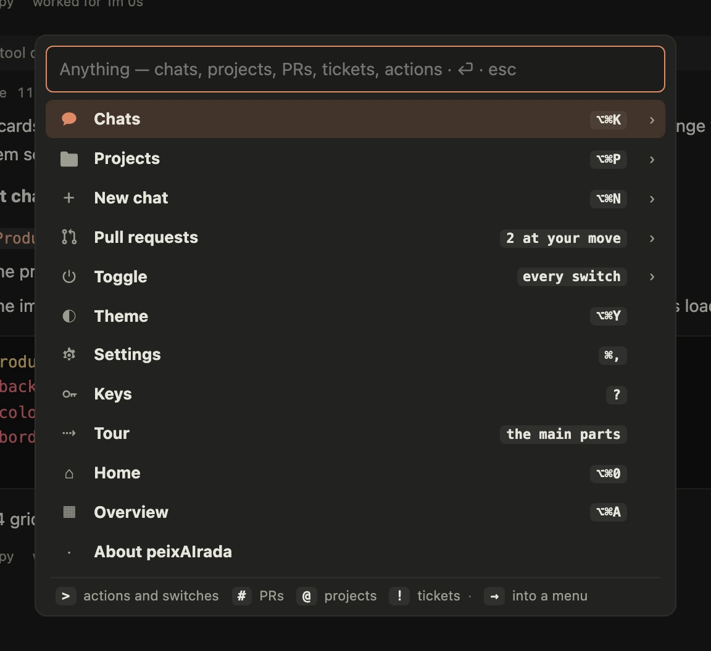

# peixAIrada — the guide

Everything the [README](../README.md) leaves out: every feature, the keys, installing in full, the settings and the
setup file, and how the pictures are made.

- [The board](#the-board) · [Beside a chat](#beside-a-chat) · [Make it yours](#make-it-yours) · [Keys](#keys)
- [Install in full](#install-in-full) · [Settings and setup](#settings-and-setup) · [Hacking](#hacking)

## The board

- 🚦 **Sorted by who owes whom** — in lanes: asking you, clauding, watching (Claude will come back by itself: a
  monitor or a command still running, or a wake-up it set — *wakes at 14:30 · in 52 min*), then the rest by their last
  word — ready, and idle (untouched for more than four days). Each lane's head wears its state's glyph and stays at the
  top while its lane scrolls under it. A turn that ended on an API error, the token limit or a refusal says *stopped*
  and why on its card. *Done* is a tick you give — on a watching chat it says what it would end and asks once more;
  Idle and Done start folded, and a click on any lane's head folds or opens it. **The funnel** beside the search shows only the chats with a PR at your move, or only those
  Claude answered since you last looked. Cards are compact unless you'd rather — or large only for the chats that want
  you.
- 💡 **The card's edge tells you why it's busy** — each card a lit edge in its project's colour; a light runs round it
  while Claude works, one per sub-agent, slower for a monitor; a question pings out in red.
- 🔔 **Alerts** — a notification when a chat finishes or needs you, answered where it shows in the app: *Reply…*
  (straight into the chat's Claude, when it runs here), *Done*, or *In 15 minutes*. The Dock badge counts the chats asking
  you and those with a new reply. The fish in the menu bar is dim when nothing wants you and full when something does, and
  its number is the questions alone; it floats belly-up if the server dies. Its menu leads with what to do next; hold ⌥
  and a reply's row marks it read. Settings › General can give it a key that works in any app.
- 🔕 **A chat muted** — its card's right-click, ··· in its header, the launcher, or *Mute this chat* on its notification: no
  banner, sound or count from it, its questions included, until you unmute it. Its card says *muted* beside the project and
  keeps showing what the chat does; a click on the word unmutes it.
- ▶️ **Next** — ⌥⌘⏎, or the button on the status bar: the question waiting longest, then a PR at your move, then what to
  read, always in that order. Back after a while, a line over the fish says what changed while you were out.
- 🎣 **Gone fishing** — a quiet you choose, from the status bar's right-click or the fish's menu: questions still ring, the
  rest waits 25 minutes and arrives as one. Red on the status bar only ever means a chat is asking you, and with
  notifications off a mark says so. Settings › Appearance has two trials for the fish's lane: a fish per chat, and your
  day as the seabed.
- 🐙 **PRs** — on a card, a small square for each, in its state's colour (a draft hollow); PRs stacked on each other on
  GitHub sit together, joined by a line, base first. The number before them is the PR at your move, in the accent —
  else the one updated last. The squares keep their size however many there are; past the row's room they scroll
  under the pointer. Hover a square (or the number) and it lifts, with a card about its PR: the repo and state, its
  number and title, CI, its place in a stack, whose move and why, who's on it and when it last changed; click it for
  the PR. Rest the pointer anywhere else on the card for every PR the chat has and their latest events. The chat's header has the same squares,
  in up to three rows when there are many, with its CI on them: a red ring when it fails, a pulse while it runs, and the number's own tick, cross or ring;
  its tickets are dots after them, and the git mark beside them says how many there are and lists them, one row each. ⌥-click the ✓ to tick a chat done for good: its
  PRs won't bring it back. Take a PR off a chat from its square's right-click menu (or ⌥-click a square in the header) —
  until you name it there yourself.
- 💬 **Chats that talk** — when one chat messages another (Claude Code's SendMessage), the card that got it says
  *← from* the chat that sent it, and its transcript shows the message where it arrived — or *queued*, while the chat
  is at work —, the sender a click away; the sender's SendMessage links back. A message is never counted as yours.
- 🤿 **Its agents, on its card** — while a chat's sub-agents or teammates work, its card opens to a row each: what it was
  asked, what it is doing, how long it has been at it, and *quiet 4m* when it has gone silent. Three show, then *+N more*.
  One that finishes goes into a *done* row, whose click lists what each found; one that fails stays until you open the
  chat, turns the chip red and sends an alert. Click a row for its transcript, in a read-only tab beside the chat; hover
  for its worktree and totals; right-click to ask Claude to stop it. The *3 agents* chip folds the rows, and the card
  remembers. The same rows sit under the transcript of the chat you are reading. They open at every card size: under
  *Same height* the card grows while it has them, and folded or done it is back to one height. Once one has ended and left
  the card, the agent's call stays in the chat as a line of its own: *its transcript ›* still opens it.
- 🎫 **Jira tickets** — a ticket a chat names (`ACME-12`, a link, its branch) wears its status on the card and in the
  header, beside its PRs. Set your site, email and an API token in Setup.
- 🎨 **Projects** — folders, or named sets of folders, each in a colour of your choosing.
- 🏠 **Home** — with no chat open (⌥⌘0): an ASCII sunset at sea with our fish leaping across the sun (click it), the
  board at a glance — each count a way to what it counts — and your day, every chat's turns and how long each waited
  on you.
- 🐟 **It moves when something happens** — counts roll to their new value, a ✓ draws itself, an answered question's
  ring closes in, a PR's CI is drawn in as it lands; a clauding card names the tool it is running, a monitor's card
  its newest event; a pixel fish in the status bar swims faster the more agents are at work, and floats belly-up
  while the board has lost its server. In the app the trackpad bumps as a divider snaps; sounds, if you switch them
  on. All of it stills under the system's *reduce motion*.
- 📊 **A status bar** — along the window's foot: the search, the connection, what asks you, the board's own update,
  the faces on your PRs, your plan's limits (or its monthly spend cap) as small pies, keeping the Mac awake (with the
  lid closed too, by Touch ID where sudo takes it), CPU and memory, and the time.
- 🤝 **One chat to another** — right-click a card: *Send to this chat…* writes your words into its Claude (a chat
  with no Claude running resumes in a drawer with them); ⌥⌘L's *Send to a chat…* picks one. A chat running in iTerm or
  VS Code is out of reach, and says so. *Merge with…* takes two or more chats into a new one: the board writes where
  each stands — Claude Code's own recap where it has one —, you read and change it, pick the folder, and Start opens
  the new chat with it as its first prompt; the old ones stay, each marked *merged*. *Fold into…* types one chat's
  handoff into another's Claude — not sent, for you to read and send — and ticks the first one done; or drag its card
  onto the other: the chat it would go into lights, Esc puts it back, and letting go asks before anything happens. *Branch from
  here* (a card's menu, or the chat's ···) opens a copy of the chat in a drawer of its own, to try another way while
  the first goes on as it was.

<table>
  <tr>
    <td></td>
    <td></td>
  </tr>
  <tr>
    <td align="center"><sub>asking · clauding, your move on its PR · sub-agents · watching</sub></td>
    <td align="center"><sub>point at the scrollbar and the days come out</sub></td>
  </tr>
</table>

<p align="center"><br><sub>⌥⌘0 — home: the board at a glance, and your day</sub></p>

## Beside a chat

Each is a tab of the chat; the column splits in two halves when there's more than one thing to look at.



| Key | Beside the chat |
|---|---|
| ⌥⌘C | 🖥️ **Claude Code itself** — the real terminal: resume any chat, or take over one running in iTerm or VS Code. A chat whose Claude has ended resumes on a click (or ⌥⌘C), cloning its repo first when its folder isn't checked out, and making its worktree again when that was removed (on the chat's branch). It survives the board's restarts. |
| ⌥⌘T · ⌘T | 🐚 **A shell** in the chat's folder, on a tab of its own — ⌘T opens another, or on a web page a blank tab, its address ready to type into. ⌘W closes the tab you are in. |
| ⌥⌘G | 🐙 **The PR on GitHub** — its page on a tab (a square in the header opens it too); its state, its CI and whose move it is under the header. With several, ⌥⌘G again from one picks another. |
| ⌥⌘E · ⌥⌘V | 🧩 **The in-app editor** on the chat's folder, on a tab: VS Code Web, or vim in a terminal (Settings › General › In-app editor) — or ⌥⌘V, the folder in the external editor: VS Code, or Zed (Settings › General › External editor), in its own window. A file path clicked in a chat opens there at its line. |
| ⌥⌘D | 🔀 **The chat's changes** — this turn's edits, everything uncommitted, the branch against its base, or a PR's, as a diff. Commit… and Push type into its shell; a note on a line goes to Claude. |
| ⌘2 · ⌥⌘2 | ◫ **Split** the column side by side, or one half over the other; drag a tab across, ⌘0 closes the other half. Press a tab's key again from it (⌥⌘C, ⌥⌘T, ⌥⌘G, ⌥⌘E, ⌥⌘D) and its half fills the column (⌥⌘G with several PRs: their picker first); once more, both are back. |

GitHub and VS Code open in the chat in the Mac app; in a browser they open in a tab of their own. In the app GitHub's pages
open on a tab of the chat and every other page in your browser, a link out of a page to another site too; Settings ›
General › Links keeps more sites in the board (an address's start each, like `github.com/acme` or `localhost:3000`), or
every page. Any part of a card can be left out, or the age and the ✓ kept at rest: Settings › Chat list holds a card with every part on it,
and a click on one flips it. The PR list under the header is as tall as you drag its foot.

<table>
  <tr>
    <td></td>
    <td></td>
  </tr>
  <tr>
    <td align="center"><sub>⌥⌘D — the diff of what Claude just did, the list hidden for the room (⌥⌘B)</sub></td>
    <td align="center"><sub>⌥⌘A — every agent at once, by what it wants from you</sub></td>
  </tr>
</table>

## Make it yours

Every look is in Settings › Appearance and Chat list (⌘,), or a key: the chat list hidden and the chat the whole width
(⌥⌘B, or the first button in the status bar, whose mark says which). A theme comes in two halves, dark and light, and
*Appearance* — Auto (following macOS), Dark or Light — picks the half: pick Tokyo Night and it is Night after dark and
Day by day. Beside the board's own are Tokyo Night, Catppuccin, Gruvbox, Rosé Pine, Everforest, Kanagawa, Flexoki and
Nord, each with both halves, and three with one — Black, the board's own colours on true black; Matte Black; and
Softened, the board's light with no white in it —, the board's own wearing the other half (⌥⌘Y shows them all on the
board as you move). Every theme lays the chat in a frame — the window, the list and the status bar — a step apart from it (in
peixAIrada's dark, the grey of the settings' own sidebar),
and *Dark frame* makes that frame the theme's dark half round a light chat. Your projects keep their hue in the
theme's shades, and in every theme the small text reads at 4.5:1 or better. The board is a Mac window: the chats a
sidebar of rows, a ring of light round a chat at work and sonar round a question, the open chat solid in its
project's colour. Each row names its project on a tab of its colour in its top-left corner, and the toolbar on the same tab in its own.
Narrow the list to one project (⌥⌘P, a click on the toolbar's tab, or a card's right-click menu) and that tab grows to the head of the list, the list takes a tint of its colour and
says how many of how many, and *Show all* lets go; opening a chat from another project lets go too.

<table>
  <tr>
    <td></td>
    <td></td>
  </tr>
  <tr>
    <td align="center"><sub><b>⌥⌘Y</b> — a dark theme (Tokyo Night)…</sub></td>
    <td align="center"><sub>…or a light one (Catppuccin Latte), whatever macOS shows</sub></td>
  </tr>
</table>

## Chat with the people you share it with

An optional chat between boards — off until you turn it on. One chat, with no rooms: it lives in a **private GitHub
repo**, as one issue whose comments are the messages, and every board reads it with its own `gh` login, so there is no
server to run and a Mac that slept catches up when it wakes.

- **Starting it** (whoever owns it): Settings › Chat › *A new chat* comes filled in — the newest GitHub organization
  you own and `chat` (your account if you own none) — and *Make it* makes it. The board makes the repo private and
  its one issue, *Chat* (labelled `room`). A free GitHub organization is the best home: there its
  members can be readers only — on a personal account every collaborator can also push and delete anyone's messages.
- **Inviting**: the chat's **People** (the two heads in its panel, the owner's alone) suggests the people of your chats'
  PRs, most often first, and takes any GitHub login. Only the repo's admin invites, cancels an invitation or removes
  someone — GitHub refuses it from anyone else's board too.
- **Joining**: an invitation shows as *invited* in the status bar and in Settings › Chat, with *Join*; GitHub mails it
  too. A chat you're already in is listed under *Your chats*, with *Use*; any other by its repo, which the board checks
  with GitHub first. A chat set up whose repo you can't read (not made yet, renamed, access gone) shows with *Forget
  it* above the same choices.
- **Using it**: *chat* in the status bar opens the panel (its count is what you haven't read); ⏎ sends, ⇧⏎ is a new
  line, Esc closes. Markdown works; images don't show and links open in your browser. A message from someone else
  while the panel isn't in front of you is a notification. ··· has the chat on GitHub, its settings, and leaving.
- **Polls**: the bar chart beside the box asks a question with two to eight answers — one answer each, or *Several
  each*. Everyone's votes show under each answer, by name; a click votes, another answer moves your vote, the same one
  again takes it back. *Lunch* fills it in with your lunch places and *Not today*. A vote is a reaction on GitHub —
  the poll's message there says which reaction is which answer —, so a vote given there counts too.

The board turns off GitHub's own emails about the chat's repo for you (its notifications, *ignored*) — otherwise every
message would mail everyone. What anyone says stays in their message: nothing from the chat is ever typed into a
terminal or handed to Claude.

## Lunch

An optional reminder that it's lunch time, and the day's menus of the places you go — off until Settings › Lunch
turns it on. Give it a time (the reminder's), the days, and each place with its Instagram account.

- **Before lunch**, through the morning, the board reads each place's menu: its posts as anyone sees them — a week's
  card, a month's dishes, a closure — and, with *Read the stories* on and an Instagram account logged in
  (*Log in to Instagram…* opens a window; it closes itself once you're in), its stories, where most places post the
  day's menu. A Slack channel where colleagues post the menus as screenshots is read too, if you name one. Claude reads
  each picture once, on your plan (*Read by*: Haiku unless you pick Sonnet).
- **⌥⌘M** shows them on a chalkboard, any time; home shows it too until lunch. A place's name opens its Instagram in
  your browser. *Read again* reads them now. With the chat on, *Ask the chat* asks who's going, and where, as a poll.
- **At lunch time** a sign drops into the status bar's lane over the fish — *LUNCH* — and the day's dishes scroll under
  it; a click on either is the chalkboard. A notification comes with *Menus · Going · In 15 minutes*.
- **Going**: the sign says *ENJOY* and the fish swims off the bar. Lock the Mac and it reads *BACK SOON*; come back
  (ten minutes on, at least) and the fish swims in fed, burps, and the sign says how long you were out.

The stories need a login because Instagram shows a story to no one logged out. A second account just for this is wiser
than your own: one that watches stories on a schedule can be challenged.

## Zé's game

**⌥⌘Z** is a break: Zé, the Bruce Lee of Barcelos, eats the meat that falls and gets buff; every vegetable makes him
thinner, and when only his bones are left it's over — dodge them, or kick them out of the sky. Mind the burger: it has
lettuce. Six meats in a row bring a Ford Focus (five fast seconds); three greens, a Mercedes A-Class (five slow
ones). ← → run, ↑ jumps, space kicks (or honks), P pauses, M turns the sound off and on, T switches the music between a
vira from Barcelos and the funk; esc or ⌥⌘Z again closes it. The golden rooster is muscle, five in a row is a combo,
and level 3 is **ENTER THE DRAGON**: Zé twice his size and on fire, eating everything for sixteen seconds. Pick the
way to play on the title — EASY, NORMAL, HARD or HARDCORE (five meats in every fifty) — each with its own best. Every
five levels the greens bite harder, so a round lasts a few minutes; let one pass very close and it pays: RASPÃO! Keep
an eye out for a briefcase. It plays on a lit terrace over the Cávado, with Barcelos out of focus across the water, a new
sky every three levels and fireworks at a level-up, wherever the Mac has WebGL2.

## Keys

| Key | Does |
|---|---|
| ⌥⌘K | jump to any chat; typed, done chats too, and a PR's link finds every chat that names it |
| ⌥⌘N · ⌥⌘O | new chat · new chat in your ⌥⌘O project |
| ⌥⌘P · ⌥⌘F | pick a project, twice for every project and back · filter the list |
| ⌥⌘↑ ⌥⌘↓ | previous · next chat |
| ⌥⌘C | this chat's Claude, in the pane |
| ⌥⌘T · ⌥⌘E · ⌥⌘G | a shell · the in-app editor (VS Code Web or vim) · the PR |
| ⌥⌘V | the chat's folder in the external editor (VS Code or Zed), its own window |
| ⌘T · ⌘W | a new tab — a shell, or a page from a page · close the tab you are in (VS Code Web's editors first, as in VS Code) |
| ⌘2 · ⌘0 | split · close the other half |
| ⌥⌘B | hide the chat list, and show it again |
| ⌥⌘L | the launcher: chats, projects, PRs, tickets, actions, switches |
| ⌥⌘A · ⌥⌘D · ⌥⌘0 | the overview: every live chat at once · this chat's changes · home |
| ⌥⌘M | lunch: today's menus, on a chalkboard |
| ⌥⌘Z | Zé's game |
| ⌥⌘Y | the theme |
| ⌥⌘R · ⌘R | reload the board · reload the page in the pane (VS Code Web keeps its own ⌘R) |

`?` (or *Keyboard shortcuts* in Settings) lists the rest, grouped. A right-click on a card, a PR's square or a project's colour square has
what ⌥-click and a double-click do — rename, tick done, take a PR off, let go of a colour — and the launcher has the
same for the open chat.

<p align="center"></p>

## Install in full

**You need** macOS 13 or later, the Xcode Command Line Tools (`xcode-select --install`), Node ≥ 22 (`brew install node`,
or mise, nvm, asdf) and Claude Code, signed in. Install from the shell you use every day — the server takes its `PATH`
and its `node`, which is how it finds `claude`, `gh` and the rest (the commands are the [README's](../README.md#-install)).

**The board has a key**: only a page that holds it reads your chats or types into a terminal — a container, another
account or anything else that reaches the port gets nothing. The app has it; a browser gets it once, from
`scripts/launchd.sh open` or the button on the page that asks for it, and keeps it.

**On first open** the board asks where your repos live, its guess from your chats already filled in, then shows you
round its main parts — Skip it, or take it again later from Settings, ⌥⌘L or home; macOS asks to let `security` read
the *Claude Code-credentials* keychain item (your plan usage — *Always Allow*), and the app to show notifications.

**Optional** — each adds one thing:

| | Adds | Install |
|---|---|---|
| [GitHub CLI](https://cli.github.com), signed in | PRs — their state, CI, faces and whose move — and cloning repos | `brew install gh && gh auth login` |
| VS Code | ⌥⌘E (VS Code Web beside the chat) and file links | [code.visualstudio.com](https://code.visualstudio.com) |
| [Zed](https://zed.dev) | file links in Zed instead (Settings › General) | none: picking it installs it |
| [Task](https://taskfile.dev) | new chats in folders whose Taskfile starts Claude (folders Claude Code trusts) | `brew install go-task` |

**Updating**: the status bar says when new commits have come; click it and it pulls them — a fast-forward that leaves
your own changes as they are — and restarts only what they changed: the packages, the server (your chats stay open),
the page, the app. When a file you changed is one the commits change too, or your branch has commits of its own,
Settings › Updates & access says so, with the command that clears the way under Details. *Update automatically* pulls on its own once you've left the
board be for two minutes, and never while a file is changed here. By hand: `git pull && npm install &&
scripts/launchd.sh restart` — the board's page follows —, and `mac/build.sh install` when `mac/` changed. After
switching Node versions, or installing a CLI outside the `PATH` you installed with, run the last two install lines
again.

**Removing**: `scripts/launchd.sh uninstall`, then delete `/Applications/peixAIrada.app` — and `~/.config/peixairada`
and `~/Library/Application Support/peixAIrada` to forget your setup and the board's state.

## Settings and setup

**Settings** — ⌘, or ··· in the chat's header — is a sidebar of panes with a search box on top (type *dark*, *zoom*
or *key* to find a setting wherever it is):

- **General** — notifications and sounds, which editor a file path opens in, and (in the app) which full screen ⌃⌘F is.
- **Appearance** — Auto, Dark or Light (Auto follows macOS), the theme — a swatch each, its dark and light halves
  (⌥⌘Y shows them all on the board) —, a dark frame round the light chat, the text size, and what else the status
  bar shows (a right-click on the bar picks that too).
- **Chat list** — a card you click to choose its parts; the card size (*One line* keeps every card one height, with a line for the question, your move, what it is doing or the last word; or larger only where a chat needs you); *Its words on one line*, for the last word at Medium, and the prompt and reply at Large.
- **Terminal** — ⌥ as Meta, and a screen reader in the drawer (on by itself while VoiceOver runs).
- **Projects** — your repo folders and their GitHub org (⌥⌘N lists every repo and clones the ones you don't have), the
  project ⌥⌘O starts a chat in, a colour per project, and the projects you hid.
- **Jira** — your site, email and API token (the token goes to your keychain, never into the file).
- **Chat** — the chat's repo: a new one, one you're in, an invitation to join; or leaving it (see below).
- **Updates & access** — where the board's update stands and whether it updates itself (off to begin with: the status
  bar says when new commits came, and *Update now* takes them), whether the board's key is required yet and a new key
  (every browser then asks for it again), and where the setup file is.

The sidebar's foot has the keyboard shortcuts and the tour.

The setup is a file of yours, `~/.config/peixairada/config.json` (`$XDG_CONFIG_HOME` moves it) — edit it by hand or
keep it with your dotfiles; the board picks up a change within seconds:

```json
{
  "roots": [{ "dir": "~/code", "org": "my-org" }],
  "quick": "my-service",
  "projects": { "my-service": { "abbr": "SVC", "color": "#2f7fd8" } },
  "jira": { "site": "https://my-org.atlassian.net", "email": "me@my-org.com" },
  "chat": { "repo": "my-org/chat" }
}
```

What the board records as you use it — done ticks, titles, pins — stays in `~/Library/Application Support/peixAIrada/`,
with its key (`key`) and VS Code Web's token (`vsweb-token`).

**What leaves your machine**: only `gh` (PR states, clones), the plan-usage call, Jira (once you set it up), the
chat's GitHub calls (once you join one — with none, a look for an invitation every ten minutes), a `git
fetch` of the board's own checkout every half hour (its updates) and, with VS Code installed, an hourly look at VS
Code's update service (so VS Code Web has its newest build before you open it). Transcripts hold everything Claude
read: keep the server on `127.0.0.1` — past it, the key crosses your network unencrypted.

<details>
<summary>Environment variables</summary>

| Variable | Default | |
|---|---|---|
| `PORT` | `7331` | the board's port |
| `NOTIFY` | `native` (`off` with the app) | who posts notifications |
| `USAGE` | on | `off` hides the plan usage |
| `JIRA_API_TOKEN` | the keychain's | the Jira token, if you'd rather not keep it in the keychain |
| `DRAWER_IDLE_MS` | 24 h | an unwatched idle Claude in the pane ends itself; `0` never |
| `VSWEB_FRESH_MS` | 1 h | how often VS Code Web's newest build is fetched ahead of time; `0` never |
| `CLAUDE_BIN` `GH_BIN` `CODE_BIN` `TASK_BIN` | from `PATH` | where the CLIs are |
| `CLAUDE_DIR` · `STATE_FILE` | `~/.claude` · `~/Library/Application Support/peixAIrada/state.json` | what it reads · keeps |
| `CONFIG_FILE` | `~/.config/peixairada/config.json` (beside `STATE_FILE` when that is set) | the setup |
| `KEY_MODE` | — | `enforce`: the key from the first request, before the app has opened with it |

The login agent takes `PORT`, `NOTIFY` and your `PATH` at `scripts/launchd.sh install`.

</details>

## Hacking

`npm test` · `npm run check` · `npm run scenarios`. The pictures are taken on a made-up board
(`scripts/readme-board.mjs`), never yours: `npm run scenario -- scripts/readme-shots.mjs` redraws the stills, and
`npm run scenario -- scripts/readme-clips.mjs --timeout 900000 [-- <clip>…]` the README's clips (animated WebP, by
libwebp's `img2webp` — `brew install webp`); VS Code Web's want the `code` CLI. The browser checks drive Google Chrome
(`CHROME` points at another); `npm run webkit` runs the board in WebKit, the app's engine, and `npm run perf` measures
what it costs there on a busy made-up board (`-- --against <commit>` beside an older one, `-- --app` the app as it
runs). The API from a terminal wants the key too: `scripts/board.sh /api/terminals` sends it; `npm run verify` and
`npm run webkit` hand the page the live board's (`KEY=` for another). [CLAUDE.md](../CLAUDE.md) holds the working
notes, [DECISIONS.md](DECISIONS.md) the why.

Home's sunset is [*ocean sunset*](https://ascii.rest/ocean-sunset/) by [bas3line](https://github.com/bas3line/ascii)
(MIT), ported as it stands; the leaping fish is ours.
